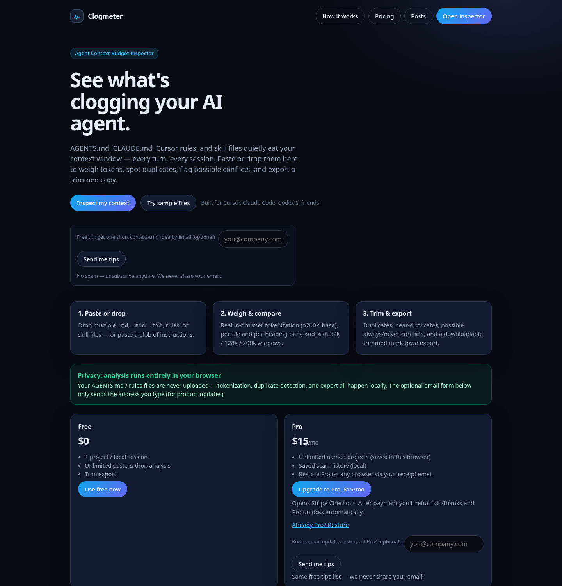

# Clogmeter

**See what's clogging your AI agent.** Clogmeter is a free, browser-only inspector for the instruction files your coding agents read on every turn: `AGENTS.md`, `CLAUDE.md`, Cursor rules (`.cursor/rules/*.mdc`, `.cursorrules`) and skill files.

👉 **Try it live: [clogmeter.vercel.app](https://clogmeter.vercel.app)**

## What it does

- **Token weight.** Shows how many tokens each instruction file costs and how much of the context window it eats before your agent has read a line of code.
- **Duplicates.** Finds the same rule repeated across files (for example in both `AGENTS.md` and `CLAUDE.md`), so you pay for it only once.
- **Conflicts.** Flags "always" and "never" rules that contradict each other, which is a common reason agents seem to ignore instructions.
- **Trimmed export.** Exports a cleaned-up copy with duplicates removed.

Your files stay in your browser. Nothing is uploaded.

## Free tools

- [AGENTS.md / CLAUDE.md token counter](https://clogmeter.vercel.app/tools/agents-md-token-counter)
- [Cursor rules token counter](https://clogmeter.vercel.app/tools/cursor-rules-token-counter)

## Plans

| Plan | Price | What you get |
| --- | --- | --- |
| Free | $0 | 1 project per local session, unlimited paste and drop analysis, trimmed export |
| Pro | $15/mo | Unlimited named projects and local scan history in your browser, restore Pro on any browser via your receipt email |

See [pricing](https://clogmeter.vercel.app/pricing) for details.

## Guides

Short guides on keeping agent instruction files lean are at [clogmeter.vercel.app/guides](https://clogmeter.vercel.app/guides/).

## VS Code / Cursor extension

Free extension that shows the token weight of `AGENTS.md`, `CLAUDE.md` and Cursor rules in your status bar, with a local inspect panel for heavy sections, duplicates and conflicts.

- Source: [github.com/clogmeter/clogmeter-vscode](https://github.com/clogmeter/clogmeter-vscode)
- VS Code Marketplace: [clogmeter.clogmeter](https://marketplace.visualstudio.com/items?itemName=clogmeter.clogmeter)
- Open VSX: [clogmeter/clogmeter](https://open-vsx.org/extension/clogmeter/clogmeter)

## Feedback

Open an issue in this repo with bugs, ideas or files that scan oddly.

## License

The README and docs in this repository are released under the [MIT License](LICENSE). The Clogmeter app itself is not part of this repository.
